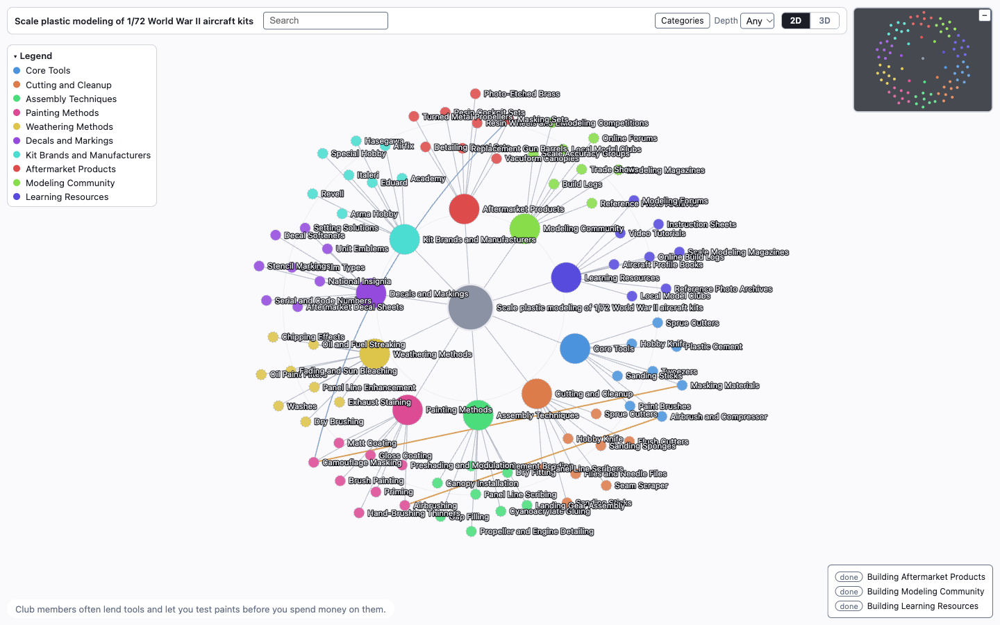

<picture>
  <source media="(prefers-color-scheme: dark)" srcset="https://raw.githubusercontent.com/Graydon-dmg/ontologizer/main/web/shared/brand/lockup-dark.svg">
  
</picture>

Ontologizer is an open-source command-line tool: give it a topic and Claude builds a live, color-coded map of everything inside it, streaming into a local web page as it goes.

```text
        manga chess jazz
       *--o     o     o--*
           \    |    /
        *   \   |   /   *
         \   \  |  /   /
 espresso O--( you )--O rust
         /   /  |  \   \
        *   /   |   \   *
           /    |    \
       *--o     o     o--*
   sourdough gunpla orbits

      every topic is a map.
      ontologizer draws it.
```



## Install

**Easiest:** point your coding agent (Claude Code, Codex, Cursor...) at [docs/AGENT-INSTALL.md](https://github.com/Graydon-dmg/ontologizer/blob/main/docs/AGENT-INSTALL.md) and ask it to install Ontologizer.

**Manual:**

1. Install it:

   ```bash
   npm i -g ontologizer
   ```

2. Start it and pick **New**. The first time it needs Claude, it asks for your Anthropic API key once and stores it in your system keychain:

   ```bash
   ontologizer
   ```

3. Check that everything is in place:

   ```bash
   ontologizer doctor
   ```

## Your first map in 30 seconds

```bash
ontologizer new
```

You will see a few context check questions, then the map streams in live in your browser. When you like it, save it with `ontologizer save [name]`.

Then click **Chat** to ask the map questions: answers cite your map's nodes and, when needed, the web. Paste an image to ask about it.

No key or network yet? Run `ontologizer load demo --replay` to watch the bundled demo build itself offline.

## Commands

| Command | What it does |
| --- | --- |
| `ontologizer` | Interactive start menu |
| `ontologizer new` | Build a new topic map |
| `ontologizer load <name>` | Open a saved map (add `--replay` to watch it build again) |
| `ontologizer save [name]` | Save the current draft |
| `ontologizer list` | List saved maps |
| `ontologizer fuse <a> <b>` | Fuse two maps into a new draft |
| `ontologizer rosetta <map>` | Add a lens that re-explains the map for a persona |
| `ontologizer explain <name> <node>` | Write an article for one node |
| `ontologizer research <name> <node>` | Grow the map under one node |
| `ontologizer update` | Update ontologizer to the latest version |
| `ontologizer key [action]` | Show, set or clear the Anthropic API key |
| `ontologizer doctor` | Check that everything ontologizer needs is in place |
| `ontologizer completion [shell]` | Print a shell completion script (zsh, bash or fish) |

Every command takes `--help`. Full detail is in the [guide](https://github.com/Graydon-dmg/ontologizer/blob/main/docs/GUIDE.md).

## Requirements

- Node 22+
- An Anthropic API key

## Cost and privacy

- Model calls go to Anthropic's API using your own key. A map costs a few cents of API usage; Explain, Research and Sources (in the node menu or as commands), `fuse` and `rosetta` each make extra calls.
- Maps are stored locally in `~/.ontologizer`.
- The page is served only on 127.0.0.1 (your own machine).

See [SECURITY.md](https://github.com/Graydon-dmg/ontologizer/blob/main/SECURITY.md).

## Licence

MIT: see [LICENSE](https://github.com/Graydon-dmg/ontologizer/blob/main/LICENSE). The Ontologizer name and logo are trademarks: see [TRADEMARKS.md](https://github.com/Graydon-dmg/ontologizer/blob/main/TRADEMARKS.md). Third-party licences are listed in [THIRD_PARTY_NOTICES.md](https://github.com/Graydon-dmg/ontologizer/blob/main/THIRD_PARTY_NOTICES.md). Contributions welcome: see [CONTRIBUTING.md](https://github.com/Graydon-dmg/ontologizer/blob/main/CONTRIBUTING.md).
